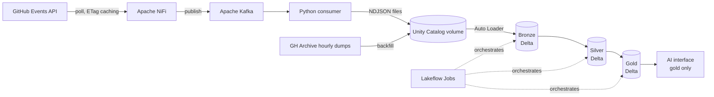

# GitPulse

A self-directed data platform project that ingests GitHub's public event stream and moves it through a full medallion architecture (bronze → silver → gold) on Databricks, with an AI interface over the gold layer, and is operated the way a production platform would be.

## Why this project exists

I'm a senior data engineer using time between roles deliberately: closing specific, named skills gaps rather than working through generic tutorials. Every phase of this project maps to a concrete requirement drawn from real job adverts I've applied against — see [`docs/adr/`](docs/adr/) for the reasoning behind each significant decision, and [`docs/phases/`](docs/phases/) for what was actually built, what broke, and what I'd do differently, phase by phase.

This is a personal learning project, built and documented in the open so the process — not just a finished result — is visible.

## Status

**Phase 1 — Local streaming ingestion** (in progress). NiFi → Kafka runs end to end against the live GitHub Events API; the Python consumer, tests and CI are next. See [`docs/phases/phase-1-log.md`](docs/phases/phase-1-log.md) for the live working log.

In November 2026 the project changed direction: the lakehouse moves to Databricks, a high-volume historical source is added, and the code is written by me rather than generated. The reasoning is in [ADR-0008](docs/adr/0008-databricks-lakehouse-and-ai-working-agreement.md); the pre-pivot state is tagged [`v0.1-nifi-kafka-ingestion`](../../tree/v0.1-nifi-kafka-ingestion).

## Planned architecture

Two sources feed one model: the live NiFi/Kafka path is a low-volume trickle, and [GH Archive](https://www.gharchive.org/)'s hourly dumps of the same event stream provide the volume that surfaces real lakehouse problems — skew, small files, schema drift, late data and safe backfills. Bronze → silver → gold runs as Lakeflow Spark Declarative Pipelines with data-quality expectations on Databricks Free Edition, governed by Unity Catalog and deployed as a Declarative Automation Bundle through GitHub Actions. Local PySpark with Delta Lake in Docker covers Spark UI tuning that serverless compute hides. Full reasoning for each choice is in [`docs/adr/`](docs/adr/).

## How AI is used in this project

The code here is written by me. AI tools (Claude, Databricks Genie Code) explain, review and challenge by default. Where work is deliberately delegated to an agent — or built twice, once by me and once by an agent, to compare — the pull request records what was delegated and what I checked. The working agreement is in [`CLAUDE.md`](CLAUDE.md) and [ADR-0008](docs/adr/0008-databricks-lakehouse-and-ai-working-agreement.md).

## Repository structure

- `docs/adr/` — architecture decision records: what was decided and why.
- `docs/constitution.md` — the principles every decision is held to.
- `docs/phases/` — a live log per in-progress phase, and a short retrospective once each phase is done.
- `docs/runbooks/` — step-by-step operational procedures.
- `docs/archive/` — retired material, including Phase 1's original Spec Kit specification.
- `src/`, `tests/`, `infra/`, `nifi/`, `config/` — the consumer, its tests, the local NiFi/Kafka stack and the shared topic routing.

## Roadmap

| Phase | Focus | Status |
|---|---|---|
| 0 | Foundations — repo, budget guardrails, Phase 1 specification | Done |
| 1 | Local streaming ingestion — NiFi → Kafka → Python consumer → raw/quarantine, tested from day one | In progress |
| 2 | Databricks lakehouse — Auto Loader, bronze/silver/gold in Delta, GH Archive backfill, written-up investigations of real data problems | Not started |
| 3 | Production practices — Lakeflow Declarative Pipelines with expectations, Lakeflow Jobs, Bundles via GitHub Actions, Unity Catalog governance, incident drills | Not started |
| 4 | The AI boundary — an LLM step inside a pipeline, a natural-language interface over gold only | Not started |
| Stretch | Kubernetes, Argo CD and Helm; FastAPI; dbt; cloud cost as a dataset | — |

## Licence

[MIT](LICENSE).
